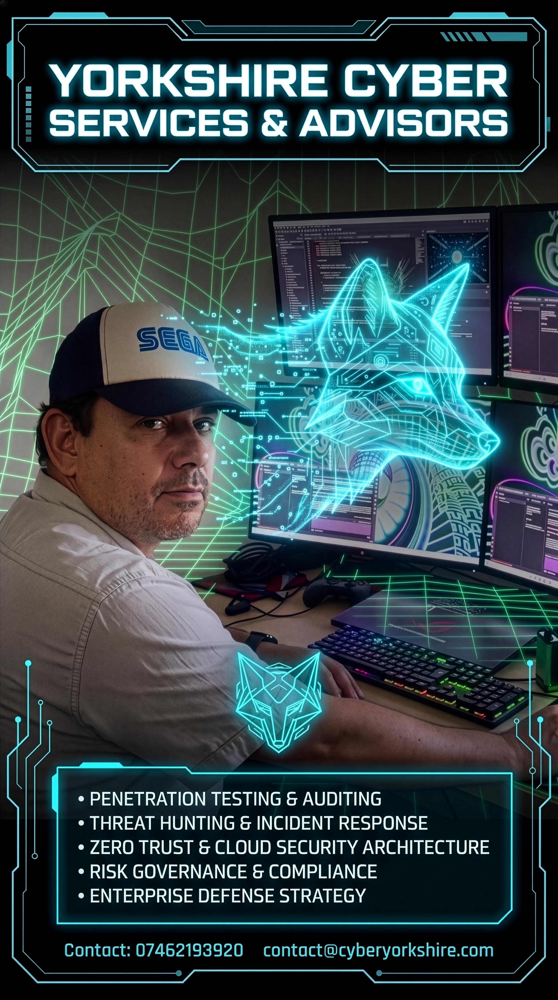

# CyberYorkshire.com - Official Website Repository

**Cyber Yorkshire | Yorkshire Cyber Services & Advisors**  
Live Route: [https://cyberyorkshire.com/](https://cyberyorkshire.com/)  
Headquarters: Leeds, West Yorkshire, United Kingdom  
Official Contact: [contact@cyberyorkshire.com](mailto:contact@cyberyorkshire.com) | Mobile: `07462193920`

---

## 🛡️ Overview

This repository contains the initial 1st website route for **Cyber Yorkshire**, built around the two core visual identity assets:
1. **Masked Face Emblem / Logo**: Showcased in the navigation header, the hero holographic tactical HUD frame, and site metadata/favicons.
2. **Yorkshire Cyber Services Flyer**: Highlighted in an interactive showcase with one-click full-resolution zoom lightbox and direct download capabilities.

---

## ⚡ Architecture & Structure

```
CyberYorkshire.com/
├── index.html                   # Primary landing page route (https://cyberyorkshire.com/)
├── cyber-yorkshire-advert.jpg   # Primary advert / launch flyer image for straightforward updates
├── favicon.ico                  # 32x32 pixel browser favicon
├── README.md                    # Project documentation & deployment guide
└── assets/
    ├── css/
    │   └── style.css            # Custom cyber dark-mode theme, animations & responsive grid
    ├── js/
    │   └── main.js              # Navigation toggling, flyer lightbox, and interactive inquiry form
    └── images/
        ├── cyber-yorkshire-advert.jpg # Copy of the advert image inside assets/images/
        ├── logo.png             # Master masked face emblem (square)
        ├── logo.webp            # High-performance web-optimized logo
        ├── flyer.png            # Master full-resolution launch flyer
        ├── flyer.webp           # Web-optimized flyer
        ├── flyer-display.webp   # Crisp preview flyer for instant page loading
        └── favicon-192.png      # 192x192 Web App / Android touch icon
```

---

## 🖼️ Updating the Advert & Contact Info

To update the advert displayed on the website, replace `cyber-yorkshire-advert.jpg` in the project root directory. The landing page references this expected file path directly so content updates are straightforward:

```html

<p>Email: <a href="mailto:contact@cyberyorkshire.com">contact@cyberyorkshire.com</a></p>
<p>Phone: <a href="tel:07462193920">07462193920</a></p>
```

---

## 🚀 Core Services Featured

Directly aligned with the official Yorkshire Cyber Services brief:
1. **Penetration Testing & Auditing** - Web, API, mobile application, and internal/external network ethical penetration testing with actionable remediation roadmaps.
2. **Threat Hunting & Incident Response** - Hypothesis-driven adversary hunting, rapid breach triage, containment, and digital forensics.
3. **Zero Trust & Cloud Security Architecture** - Identity-first access controls, micro-segmentation, and AWS / Azure / GCP posture hardening.
4. **Risk Governance & Compliance** - Cyber Essentials / Plus, ISO 27001 readiness, UK GDPR safeguards, and executive boardroom risk reporting.
5. **Enterprise Defense Strategy** - Virtual/Fractional CISO leadership, red-teaming simulations, threat modeling, and employee resilience training.

---

## 💻 Local Testing & Preview

To preview the website locally in any browser:

```bash
# Start a local HTTP server
python -m http.server 8080

# Open in browser:
# http://localhost:8080/
```

---

## 🔒 Contact & Advisory
- **Mobile**: `07462193920`
- **Email**: `contact@cyberyorkshire.com`
- **Location**: Leeds, United Kingdom
- **Copyright**: © 2027 Cyber Yorkshire. All rights reserved.
